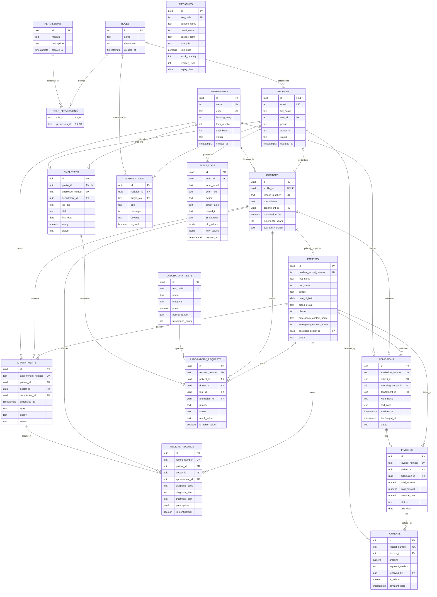

# MedPulse Hospital Management System (HMS)

MedPulse HMS is an enterprise-grade Hospital Information System (HIS) and Electronic Health Record (EHR) platform built with React, TypeScript, Vite, Tailwind CSS, shadcn-inspired modular UI components, TanStack Query, Recharts, and Supabase PostgreSQL with Row Level Security (RLS).

---

## Technology Stack

- **Frontend Core**: React 18, TypeScript 5, Vite 6
- **Styling & Design System**: Tailwind CSS v3, PostCSS, Class Variance Authority (`cva`), `clsx`, `tailwind-merge`
- **Iconography**: Lucide React
- **Routing & Navigation**: React Router v6
- **Forms & Validation**: React Hook Form, Zod, `@hookform/resolvers`
- **Data Fetching & Cache**: TanStack Query v5 (`@tanstack/react-query`)
- **Clinical Data Visualizations**: Recharts v2 (Bar, Area, and Line charts)
- **Backend & Cloud Database**: Supabase (`@supabase/supabase-js`), PostgreSQL with Row Level Security (RLS)
- **Testing**: Node Native Test Runner with automated RBAC and security test suites

---

## Entity-Relationship Diagram (ERD)

The complete 18-table database schema designed for enterprise clinical governance, audit compliance, and departmental workflows:



---

## 7 Hospital Roles & Centralized RBAC

The system defines 7 canonical roles with strict least-privilege access enforcement:

| Role | Access Scope | Restricted Operations |
| :--- | :--- | :--- |
| **Administrator** | Universal system governance, staff management, audit logs, and settings. | None. Full supervisory control. |
| **Doctor** | Consultations, EMR/EHR notes, diagnostic orders, prescription issuance. | Cannot modify billing/refunds, HR records, or system settings. |
| **Nurse** | Patient vitals triage, inpatient ward bed admissions, medicine delivery. | Cannot create EMR notes, verify lab results, or view billing. |
| **Receptionist** | Patient intake registration, appointment scheduling, front-desk intake billing. | Cannot view clinical notes, lab results, or audit logs. |
| **Laboratory Staff** | Diagnostic orders processing, specimen entry, and panic value verification. | Cannot access pharmacy inventory, billing, or inpatient beds. |
| **Pharmacist** | Prescription verification, dispensing queue, and formulary inventory batches. | Cannot modify EMR notes, inpatient beds, or process billing. |
| **Accountant** | Patient billing, itemized invoices, payment posting, and refund authorizations. | Cannot view confidential clinical records or admit patients. |

---

## Security & Row Level Security (RLS)

1. **Explicit Table Policies**:
   - Every single table has Row Level Security enabled (`ENABLE ROW LEVEL SECURITY`).
   - Granular policies define separate permissions for `SELECT`, `INSERT`, `UPDATE`, and `DELETE`.
2. **Role Escalation Prevention**:
   - Non-administrators cannot change their own or others' roles in `public.profiles`.
   - Database trigger `trg_prevent_role_escalation` throws an exception if any unauthorized user attempts role alteration.
3. **Immutable HIPAA Audit Logging**:
   - `UPDATE`, `DELETE`, and `TRUNCATE` operations on `audit_logs` are strictly revoked from all users.
   - Database trigger `audit_table_changes()` automatically logs inserts, updates, and deletes with actor, timestamp, record ID, and sanitized diffs.
   - **Sensitive Data Redaction**: Passwords, auth tokens, API secrets, CVVs, and credit card numbers are scrubbed before logging.
4. **Storage Access Policies**:
   - `medical-documents`: Restricted to doctors and clinical personnel.
   - `lab-reports`: Restricted to laboratory technologists and attending physicians.
   - `avatars`: Publicly readable, uploadable only by account owner.

---

## Core Hospital Operations Modules (Part 3)

### 1. Patient Management & Master Patient Index (MPI)
- **Sequential MRN Generation**: Automatic issuing of `MRN-YYYY-XXXXX` format patient numbers.
- **Multi-Factor Duplicate Prevention**: Pre-registration detection checks contact phone (normalized 10-digit comparison), email address, and exact First+Last name + DOB with update self-exclusion.
- **Demographics & Profile**: Full address, emergency contacts, blood group, allergies, registration dates, status, and profile pictures.
- **9-Tab Clinical Profile Modal**:
  - `Overview`: Key vitals, active allergies, status, quick actions.
  - `Personal Information`: Complete demographic records and contact info.
  - `Appointments`: Chronological appointment roster.
  - `Medical Records`: Clinical encounter history, ICD-10 diagnoses, and SOAP notes.
  - `Prescriptions`: Active and past medication orders with dosages and duration.
  - `Laboratory Results`: Specimen diagnostics with normal ranges and panic value flags.
  - `Admissions`: Inpatient bed allocations and discharge summaries.
  - `Billing`: Itemized invoices, total amounts, and payment receipts.
  - `Documents`: Document upload and management with MIME and size constraints.
- **HIPAA RBAC Enforcement**: Individual profile tabs enforce least-privilege visibility based on active user role.

### 2. Department Management
- Create, view, edit, and deactivate clinical departments.
- Tracks name, code, wing/location, floor, phone, email, department head, and total bed capacity.
- **Referential Integrity**: Hard deletion blocked if departments are linked to active doctors, appointments, or inpatient beds (`trg_prevent_department_deletion`).

### 3. Doctor Management & Availability Scheduling
- Physician registration, qualifications, license numbers, years of experience, and consultation fees.
- Links doctor records directly to authorized profile user accounts.
- Weekly availability schedule builder (Monday-Sunday, time windows, room allocations, max patients).
- Active/Inactive toggle to pause new bookings while retaining appointment rosters.

### 4. Appointment Management & Concurrency Controls
- Full state lifecycle: `Scheduled` -> `Confirmed` -> `Checked In` -> `In Progress` -> `Completed` (or `Cancelled` with mandatory reason, `No Show`).
- **Doctor Overlap Guard**: Database trigger `trg_prevent_doctor_double_booking` and application service block overlapping slots for the same physician.
- **Dual Views**: Switch between responsive data table and weekly visual schedule calendar.

### 5. Electronic Medical Records (EMR / EHR)
- Structured SOAP clinical notes (Subjective, Objective, Assessment, Plan).
- ICD-10 diagnostic coding with primary/secondary classifications.
- Vital signs recording with automatic BMI calculation and status categorization.
- Multi-item prescription ordering (drug name, dosage, frequency, route, duration, instructions).
- **Digital Signing & Immutability**: Physicians can digitally sign charts (`signed` status with cryptographic signature hash). Subsequent modifications require immutable clinical amendments (`trg_enforce_signed_record_immutability`).

### 6. Outpatient Management (OPD)
- **11-Step Clinical Encounter Workflow**:
  1. Identify / Register Patient
  2. Create Visit Token (`T-101`)
  3. Link Scheduled Appointment
  4. Check-in Patient
  5. Assign Doctor & Room
  6. Record SOAP Notes
  7. Add Diagnosis & Treatment
  8. Order Lab Tests
  9. Prescribe Medications
  10. Generate Consultation Charges
  11. Complete Visit & Discharge
- Walk-in patient queue management with triage prioritization (`Routine`, `Urgent`, `Emergency`).

### Part 5: Staff Management, Reports, Notifications & Security Hardening (Complete)
- **Staff & Human Resources Management**:
  - Employee directory with departmental allocations, shifts (`Morning`, `Evening`, `Night`, `Rotating`), and credentials.
  - Strict confidential personnel data: sensitive employee salaries are restricted to Administrators and redacted for all other roles.
  - Daily shift attendance tracking with punch times and exception notes.
  - Multi-state leave management: applications, duration calculation, and administrative approval/rejection.
  - Staff analytics: department breakdown and 24/7 shift coverage matrices.
- **Hospital Reports & Analytics (16 Live Datasets)**:
  - 1. Patient Registrations (MPI), 2. Clinical Appointments, 3. Doctor Activity, 4. Department Statistics, 5. Outpatient Visits, 6. Inpatient Admissions, 7. Laboratory Requests & Critical Results, 8. Pharmacy Stock, 9. Expired Medicines, 10. Inventory Movements, 11. Invoices & Itemized Charges, 12. Actual Cash & Payments Received, 13. Outstanding Invoices (A/R), 14. Authorized Payment Refunds, 15. Staff Attendance, 16. Personnel Leave Records.
  - **Financial Intelligence**: Strictly distinguishes Gross Billed Revenue from Actual Cash Collected and Net Realized Revenue.
  - Dynamic client-side column sorting, multi-attribute search, date range pickers, and configurable pagination (10/25/50 per page).
  - Export capabilities: RFC-4180 compliant CSV export and print-friendly PDF views (`window.print()`).
- **In-App Notifications & Clinical Dispatch**:
  - Real-time notification center with live unread counter badge in top navigation.
  - Automated triggers: STAT lab orders, critical panic values, low-stock formulary alerts, expired batches, admissions, and discharges.
  - Filtering by alert category (`All`, `Unread`, `Critical Panic`, `Warnings`, `Info`) and role-based audience scoping.
  - Mark individual read, mark all read, and click-to-view navigation to relevant clinical records.
- **Security Review & RBAC Hardening**:
  - 7 canonical roles with strict least-privilege matrix.
  - Prevention of ID-based URL parameter tampering.
  - Sensitive field sanitization: passwords, payment card numbers, CVVs, and SSNs are completely stripped from audit payloads.
  - Immutable audit logs protected against unauthorized changes.

---

## Getting Started

### 1. Prerequisites
- Node.js (v18.0.0 or higher, tested on Node v24)
- npm (tested on npm 11)

### 2. Installation
```bash
# Install dependencies
npm install --legacy-peer-deps
```

### 3. Environment Setup
Copy `.env.example` to `.env`:
```bash
cp .env.example .env
```
Provide your Supabase project credentials:
```env
VITE_SUPABASE_URL=https://your-project.supabase.co
VITE_SUPABASE_ANON_KEY=your-anon-publishable-key-here
```
> **Offline Development Note**: If `.env` is unconfigured, the application runs automatically in **HMS Setup Mode** with realistic simulated sessions for all 7 roles, allowing offline development, UI testing, and permission verification without connection failures.

### 4. Running the Development Server
```bash
npm run dev
```
Open [http://localhost:5173](http://localhost:5173) in your browser.

### 5. Running the Automated Test Suite
```bash
npm test
```
Executes all **60 automated test suites** across 18 modules covering:
- Canonical RBAC & role permissions (Admin, Doctor, Nurse, Pharmacist, Lab Tech, Accountant, Receptionist)
- Patient Master Patient Index (MPI), MRN generation, and multi-factor duplicate detection
- Department referential protection against accidental deletion
- Doctor appointment scheduling and double-booking concurrency guards
- Electronic Medical Records (EMR) digital signing and immutable clinical amendments
- 11-step outpatient clinical encounter pipeline
- Inpatient bed allocation concurrency guards, bed transfers, and nursing observations
- Laboratory sample barcode accessioning, panic alerts, and pathologist verification gates
- Pharmacy FEFO batch selection, expired medicine blocks, and atomic dispensing
- Server-side invoice recalculation, payment idempotency, and authorized refund restoration
- Staff registration and confidential salary redaction for non-administrators
- Daily shift attendance recording and punch validation
- Leave request application, duration calculation, and administrative approval
- Financial intelligence: Billed Revenue vs. Actual Cash Collected
- CSV report generation with RFC-4180 quote escaping
- In-app notification broadcasting, role scoping, and unread counters
- Audit trail immutability and sensitive field sanitization (HIPAA & PCI-DSS)

### 6. Building for Production
```bash
npm run build
```

---

## Supabase PostgreSQL Setup & Migration Instructions

To link and execute the migrations in your Supabase project:

1. **Via Supabase Dashboard SQL Editor**:
   - Navigate to [https://app.supabase.com](https://app.supabase.com) and open your project.
   - Go to the **SQL Editor**.
   - Execute the migration files sequentially:
     1. [`supabase/migrations/00001_initial_hospital_schema.sql`](file:///c:/Users/USER/Desktop/HMS/supabase/migrations/00001_initial_hospital_schema.sql)
     2. [`supabase/migrations/00002_hms_core_database_and_security.sql`](file:///c:/Users/USER/Desktop/HMS/supabase/migrations/00002_hms_core_database_and_security.sql)
     3. [`supabase/migrations/00003_audit_triggers.sql`](file:///c:/Users/USER/Desktop/HMS/supabase/migrations/00003_audit_triggers.sql)
     4. [`supabase/migrations/00004_core_operations.sql`](file:///c:/Users/USER/Desktop/HMS/supabase/migrations/00004_core_operations.sql)
     5. [`supabase/migrations/00005_advanced_clinical_and_finance.sql`](file:///c:/Users/USER/Desktop/HMS/supabase/migrations/00005_advanced_clinical_and_finance.sql)
     6. [`supabase/migrations/00006_staff_notifications_and_analytics.sql`](file:///c:/Users/USER/Desktop/HMS/supabase/migrations/00006_staff_notifications_and_analytics.sql)

2. **Via Supabase CLI**:
   ```bash
   # Link local workspace to your cloud project
   npx supabase link --project-ref your-project-ref

   # Push all migrations
   npx supabase db push

   # Seed development database with fictional clinical records
   npx supabase db reset --seed
   ```

3. **Development Seed Data**:
   - Execute [`supabase/seed.sql`](file:///c:/Users/USER/Desktop/HMS/supabase/seed.sql) to populate sample clinical departments, doctors, fictional patients, laboratory test catalog, drug formulary, inpatient beds, invoices, employees, and notifications.

---

## Backup, Recovery & Business Continuity

For complete disaster recovery procedures, point-in-time restoration (PITR), weekly backup verification drills, and RTO/RPO objectives, review the official documentation:
- [`docs/BACKUP_AND_RECOVERY.md`](file:///c:/Users/USER/Desktop/HMS/docs/BACKUP_AND_RECOVERY.md)

---

## Production Deployment Guide

### Frontend Deployment (Vercel / Netlify / Cloudflare Pages)
1. **Build Command**: `npm run build`
2. **Output Directory**: `dist`
3. **Environment Variables**:
   - `VITE_SUPABASE_URL`: Your production Supabase project URL (`https://<ref>.supabase.co`).
   - `VITE_SUPABASE_ANON_KEY`: Your production Supabase anonymous publishable key.
4. **Single Page Application (SPA) Routing**:
   Ensure client-side route rewrites are enabled:
   - For Vercel: Configured in `vercel.json` (`{ "rewrites": [{ "source": "/(.*)", "destination": "/index.html" }] }`).
   - For Netlify: Configured in `public/_redirects` (`/* /index.html 200`).

### Backend Database Deployment (Supabase)
1. Apply all 6 migrations using `npx supabase db push`.
2. Configure Row Level Security (RLS) policies on all tables.
3. Verify Private Storage buckets `medical-documents`, `lab-attachments`, and `patient-photos` with private access rules.
4. Enable Point-In-Time Recovery (PITR) and daily automated database backups.


