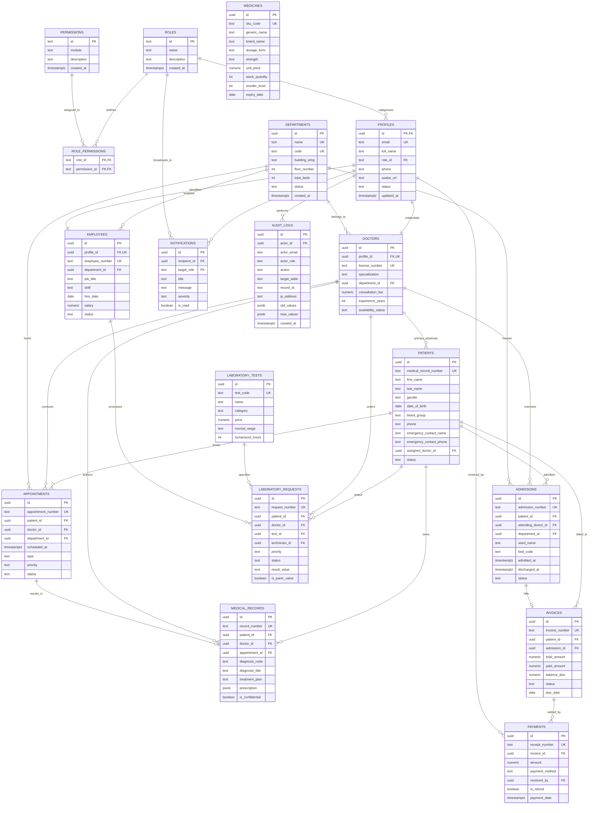

# MedPulse Hospital Management System (HMS) — Entity-Relationship Diagram

This document illustrates the complete relational database architecture of the MedPulse HMS platform implemented in PostgreSQL / Supabase.

